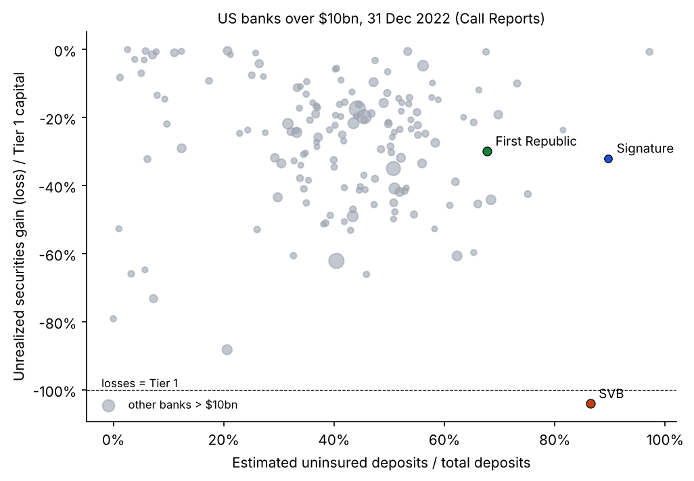

# Bastion

A bank risk and analytics platform built entirely on public data: credit risk (PD/LGD/EAD,
IFRS 9, CECL, Basel IRB), market and counterparty risk (VaR, ES, backtesting, CVA), liquidity and
ALM (LCR, NSFR, IRRBB, an SVB 2023 case study), a bank-failure early-warning model, fraud and AML
analytics, a CCAR-style stress test, and an SR 11-7-style model risk management layer.

> Research and portfolio project. Not a production risk system, not a regulatory submission,
> not investment or credit advice. No real customer data is used.

**Status:** M0 (data platform), M4 (market risk), M5 (counterparty risk), M6 (ALM, IRRBB, liquidity) and M7 (SVB case study, bank early-warning model) complete. See [docs/ROADMAP.md](docs/ROADMAP.md) and the full
[plan](docs/PLAN.md).

## Quick start

```bash
python -m venv .venv && . .venv/bin/activate
pip install -e ".[dev,models,orchestration]"

pytest -q                          # unit tests + dbt build over synthetic fixtures
bastion build --target ci          # dbt models and data tests over fixtures/raw

export BASTION_DATA=$HOME/bastion-data
bastion ingest --source core       # FRED, Fed scenarios, Treasury curves, FDIC failures + case study
bastion ingest --source fdic-quarter --quarters 20221231   # every insured bank, one quarter
bastion build --target dev         # build the lakehouse over real data
```

No credentials are needed for the core sources. Later milestones need a Kaggle API token and a
Freddie Mac account (see [docs/DATA.md](docs/DATA.md)).

## Layout

```
src/bastion/ingest/   checksummed downloaders + pins.json (no data in git)
src/bastion/pipelines Dagster asset graph
transform/            dbt-duckdb project: staging views, marts, reconciliation tests
fixtures/raw/         synthetic, seeded CI fixtures in each source's raw format
docs/                 PLAN, ROADMAP, DATA, ADRs, results
```

## First real-data sanity check (M0)

From the FDIC Call Report data the lakehouse builds, Silicon Valley Bank's unrealized securities
losses reached **104% of its Tier 1 capital at 2022-12-31**, with **86% of deposits uninsured**,
the two facts at the heart of its March 2023 failure. See
[docs/results/m0-data-platform.md](docs/results/m0-data-platform.md). The full case study is M7.

## M4 highlights

Synthetic multi-asset trading book (equity baskets, Treasuries, a Baa corporate bond, FX forwards,
index options) fully revalued on open daily data (Ken French, FRED, Treasury curves).

- 1-day 99% VaR at 2025-12-31: HS $1.94m, filtered HS $1.70m, delta-normal $1.41m, Monte Carlo
  Student-t $1.54m; stressed VaR (Jul 2008 to Jun 2009) $4.75m.
- Backtest 2007 to 2025 (4,742 days, 47 exceptions expected): plain HS had 73 and fails both
  Kupiec and Christoffersen; filtered HS had 35 and passes both. In 2008 HS was in the red zone
  with 20 exceptions; FHS had 1.
- Report: [docs/results/m4-market-risk.md](docs/results/m4-market-risk.md) (`make report-m4`).

## M5 highlights

A five-swap netting set with a Baa-rated corporate is simulated under one-factor Hull-White fitted
to the 2025-12-31 Treasury curve.

- Netting cuts peak EE from $15.0m to $11.0m; a $5m-threshold CSA brings peak PFE from $31.4m to
  $7.1m and CVA from $1.50m to $0.70m.
- SA-CCR EAD is 1.32x (unmargined) and 1.21x (margined) the IMM-style 1.4 x EEPE.
- Swap pricer and swaption engine match QuantLib to 1e-8; Monte Carlo EE matches the analytic
  Jamshidian profile within MC error; SA-CCR reproduces BCBS 279 Example 1 (EAD 569).
- Report: [docs/results/m5-counterparty-risk.md](docs/results/m5-counterparty-risk.md) (`make report-m5`).

## M6 highlights

- **IRRBB from public data:** EVE under the six BCBS shocks and 12-month NII for every US bank,
  from Call Report repricing buckets and a bootstrapped Treasury curve. On its 2021-12-31 balance
  sheet, before any hike, SVB's worst EVE decline was 44% of Tier 1 (84% if uninsured deposits
  are not treated as stable) against the 15% supervisory outlier threshold.
- **Validated against what banks reported:** revaluing each bank's securities buckets under the
  actual curve move predicts reported fair-value changes with correlation 0.6-0.7 across
  1,300-1,500 banks in 2013 and 2022 (conservative by 2-3pp).
  [Results](docs/results/m6-alm-liquidity.md).

## M7 highlights

- **SVB from public filings:** unrealized securities losses passed 50% of Tier 1 in 2022-Q1 and
  100% by 2022-Q3; with securities marked to market its leverage ratio was below zero while the
  reported ratio was 8.0%. [Case study](docs/results/m7-svb-case-study.md).
- **Early-warning model** (logistic benchmark + monotone LightGBM, 514k bank-quarters 2005-2023):
  out-of-time AUC 0.95-0.96 on banks that were still well capitalised in 2010-2012. Trained on
  2006-2019 history, it ranks SVB mid-pack on its 2022-12-31 filing: a statistical model cannot
  weight a failure mode it has barely seen, which is why Bastion pairs it with rate and liquidity
  stress tests. [Results](docs/results/m7-early-warning.md).


