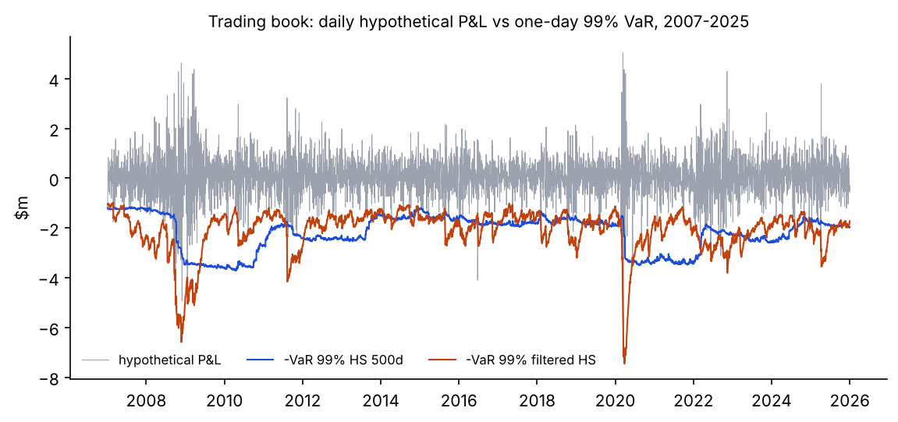

# M4: Market risk on a multi-asset trading book

Generated by `bastion report market`. Full revaluation of a synthetic multi-asset book on public
daily risk factors, 2005-2025: 12 US industry equity portfolios and the market (Kenneth French
library), Treasury zero curves bootstrapped from the daily par curve, Moody's Baa spread, VIX and
four USD exchange rates (FRED). P&L is hypothetical (positions fixed, no carry or theta), as in
the Basel backtest. Results are research, not a capital calculation.

## The book

| type           | detail             |   notional $m |
|:---------------|:-------------------|--------------:|
| equity         | equity_buseq       |            40 |
| equity         | equity_hlth        |            25 |
| equity         | equity_money       |            30 |
| equity         | equity_enrgy       |           -15 |
| equity         | equity_utils       |            10 |
| bond           | 4.0% 2.0y          |            50 |
| bond           | 4.0% 10.0y         |            40 |
| bond           | 4.5% 30.0y         |           -20 |
| corporate_bond | 5.5% 7.0y          |            30 |
| fx_forward     | fx_eur             |            25 |
| fx_forward     | fx_jpy             |           -20 |
| fx_forward     | fx_gbp             |            10 |
| option         | put K=95% T=0.25y  |            60 |
| option         | call K=105% T=0.5y |           -40 |

## VaR and Expected Shortfall at 2025-12-31

| method                                   |   1-day VaR 99% $m |   1-day ES 97.5% $m |   10-day VaR (sqrt-time) $m |
|:-----------------------------------------|-------------------:|--------------------:|----------------------------:|
| Historical simulation, 500 days          |               1.94 |                1.9  |                        6.13 |
| Historical simulation, 250 days          |               1.94 |                1.89 |                        6.13 |
| Filtered HS (EWMA 0.94), 500 days        |               1.7  |                1.57 |                        5.36 |
| Delta-normal (EWMA covariance)           |               1.41 |                1.42 |                        4.47 |
| Monte Carlo, Student-t (nu=5), 20k paths |               1.54 |                1.61 |                        4.87 |
| Stressed VaR: HS on Jul 2008 - Jun 2009  |               4.75 |                4.34 |                       15.03 |

FRTB replaces 99% VaR with 97.5% ES and scales by liquidity horizon per risk factor instead of
sqrt(10); the sqrt-time column is shown only as the familiar Basel 2.5 convention.

### By risk class (HS 500 days, 99%)

| risk class              |   standalone VaR 99% $m |
|:------------------------|------------------------:|
| equity                  |                    2.78 |
| rates                   |                    0.35 |
| credit                  |                    0.22 |
| fx                      |                    0.37 |
| options                 |                    0.5  |
| sum of standalone       |                    4.22 |
| portfolio (diversified) |                    1.94 |

## Backtest, 2007-2025

One-day 99% VaR each day from the previous 500 days, compared with the next day's hypothetical
P&L (4,742 days).

| method      |   days |   exceptions (99%) |   expected |   Kupiec p |   Christoffersen independence p |   conditional coverage p | ES Z2 (97.5%)   |
|:------------|-------:|-------------------:|-----------:|-----------:|--------------------------------:|-------------------------:|:----------------|
| HS 500d     |   4742 |                 73 |         47 |      0.001 |                           0     |                    0     | -0.44 (green)   |
| Filtered HS |   4742 |                 35 |         47 |      0.057 |                           0.477 |                    0.127 | +0.00 (green)   |

Kupiec tests the number of exceptions, Christoffersen whether they cluster, and the Acerbi-Szekely
Z2 statistic whether losses beyond the 97.5% VaR are as large as forecast by ES (0 = right,
below -0.7 yellow, below -1.8 red).

### Exceptions by year with Basel traffic-light zone

|   year |   Filtered HS |   HS 500d |   days | HS 500d zone   | Filtered HS zone   |
|-------:|--------------:|----------:|-------:|:---------------|:-------------------|
|   2007 |             3 |         7 |    247 | yellow         | green              |
|   2008 |             1 |        20 |    251 | red            | green              |
|   2009 |             1 |         1 |    250 | green          | green              |
|   2010 |             2 |         0 |    250 | green          | green              |
|   2011 |             3 |         5 |    250 | yellow         | green              |
|   2012 |             1 |         0 |    248 | green          | green              |
|   2013 |             2 |         0 |    250 | green          | green              |
|   2014 |             3 |         2 |    250 | green          | green              |
|   2015 |             2 |         6 |    250 | yellow         | green              |
|   2016 |             2 |         3 |    250 | green          | green              |
|   2017 |             2 |         0 |    250 | green          | green              |
|   2018 |             2 |         7 |    249 | yellow         | green              |
|   2019 |             1 |         1 |    250 | green          | green              |
|   2020 |             1 |         9 |    251 | yellow         | green              |
|   2021 |             1 |         0 |    250 | green          | green              |
|   2022 |             2 |         6 |    249 | yellow         | green              |
|   2023 |             0 |         0 |    249 | green          | green              |
|   2024 |             4 |         3 |    250 | green          | green              |
|   2025 |             2 |         3 |    248 | green          | green              |

## What this shows

- Over the full period plain historical simulation had 73 exceptions
  against about 47 expected, filtered HS 35. The
  difference is concentrated in turbulent years (2008: 20 vs 1):
  a 500-day window reacts slowly when volatility jumps, so its exceptions cluster, which the
  Christoffersen test picks up. Volatility filtering fixes most of that at the cost of a more
  volatile VaR.
- The four estimators at year-end 2025 differ by tens of percent. The delta-normal number is
  the lowest because it misses the option book's convexity and fat tails, which the Monte Carlo
  Student-t and historical methods keep.
- Stressed VaR on the 2008-09 window is several times today's VaR: the gap Basel 2.5 added
  stressed VaR to close.

## Limitations

- Positions are static and synthetic; no intraday trading, so actual-P&L backtesting is not
  possible until the Tickforge desk feed is wired in (M12, ADR 0006).
- Equity risk is at industry-portfolio level, not single names; options use VIX as a flat
  implied volatility (no skew or term structure).
- Corporate credit risk uses a single Baa spread factor.

Hashes: `m4-market-hashes.json`. Reproduce: `bastion ingest --source french,fred,treasury &&
bastion build --target dev && bastion report market`
