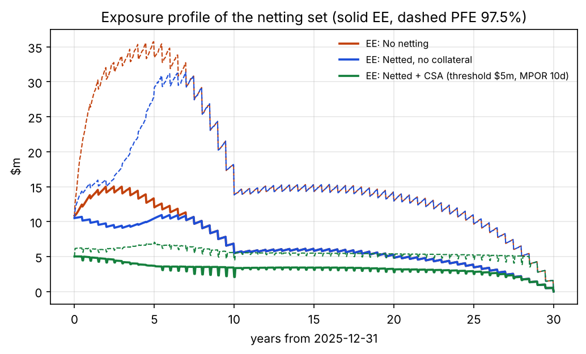

# M5: Counterparty credit risk

Generated by `bastion report ccr`. Valuation date 2025-12-31. A synthetic netting set of five USD
interest rate swaps with one Baa-rated corporate counterparty is simulated under a one-factor
Hull-White model fitted to that day's Treasury zero curve. Exposure, CVA and regulatory EAD are
compared without netting, with netting, and with a variation-margin CSA. All market inputs are
public (Treasury par curves, FRED Baa spread); the trades are illustrative.

## Summary

- **Netting cuts exposure by about a quarter.** Peak expected exposure falls from
  $15.03m with no netting to $10.95m netted; CVA falls from
  $1.813m to $1.503m. The payer and receiver swaps partly offset.
- **A CSA caps exposure near the threshold.** With a $5m threshold and a
  10-day margin period of risk, peak PFE drops from $31.37m to
  $7.05m and CVA to $0.702m. What remains is the threshold plus
  ten days of rate moves.
- **SA-CCR is more conservative than the simulation.** Its EAD is
  1.32x the IMM-style 1.4 x EEPE for the unmargined set and
  1.21x for the margined set. SA-CCR adds a fixed supervisory
  add-on to today's replacement cost and gives little credit for offsetting cash-flow timing;
  the simulation sees today's (moderate) rate volatility and the actual offsets.
- **Validated two ways.** The swap pricer matches QuantLib to 1e-8 per unit notional and the
  Jamshidian swaption price matches QuantLib's engine (both in `tests/test_ccr.py`). The Monte
  Carlo discounted EE of a single swap matches its analytic swaption profile within Monte Carlo
  error (table below), and the SA-CCR code reproduces BCBS 279 Example 1 exactly
  (EAD 569 vs 569 published).

## Model inputs

Hull-White one-factor, fitted to the volatility of daily zero-rate changes over the last
500 trading days at tenors of 2 years and above: mean reversion
a = 0.0092, sigma = 92bp per year. Counterparty credit spread
1.72% (Baa minus 10y Treasury), recovery 40%, flat hazard
rate 2.87%.

|   tenor (y) | zero rate   |   observed vol (bp/yr) |   Hull-White vol (bp/yr) | in fit   |
|------------:|:------------|-----------------------:|-------------------------:|:---------|
|        0.25 | 3.64%       |                     32 |                       91 | no       |
|        0.5  | 3.56%       |                     39 |                       91 | no       |
|        1    | 3.45%       |                     65 |                       91 | no       |
|        2    | 3.44%       |                     90 |                       91 | yes      |
|        3    | 3.52%       |                     91 |                       90 | yes      |
|        5    | 3.71%       |                     91 |                       90 | yes      |
|        7    | 3.93%       |                     90 |                       89 | yes      |
|       10    | 4.20%       |                     84 |                       87 | yes      |
|       20    | 5.00%       |                     83 |                       84 | yes      |
|       30    | 5.01%       |                     81 |                       80 | yes      |

The short end (below 2 years) is excluded: with policy rates anchored for long stretches its
realised volatility is hump-shaped, which a one-factor model with positive mean reversion cannot
produce. The fit therefore overstates very short-dated rate volatility.

## Trades

| trade             | direction     |   notional $m | start-end (y)   | fixed rate   | par rate today   |   value today $m |
|:------------------|:--------------|--------------:|:----------------|:-------------|:-----------------|-----------------:|
| payer_10y         | pay fixed     |           100 | 0-10            | 3.50%        | 4.18%            |             5.58 |
| receiver_5y       | receive fixed |           150 | 0-5             | 4.25%        | 3.73%            |             3.54 |
| payer_2y          | pay fixed     |            75 | 0-2             | 3.25%        | 3.47%            |             0.32 |
| receiver_2y7y_fwd | receive fixed |            50 | 2-7             | 4.00%        | 4.15%            |            -0.32 |
| payer_30y         | pay fixed     |            25 | 0-30            | 4.50%        | 4.85%            |             1.39 |

Net value today: $10.50m to the bank (positive = the counterparty owes us).

## Exposure and CVA

| case                                   |   EPE 1y $m |   EEPE 1y $m |   peak EE $m |   peak PFE 97.5% $m |   CVA $m |   CVA MC s.e. $m |   CVA bp of notional |
|:---------------------------------------|------------:|-------------:|-------------:|--------------------:|---------:|-----------------:|---------------------:|
| No netting                             |       12.35 |        12.39 |        15.03 |               35.74 |    1.813 |            0.008 |                 45.3 |
| Netted, no collateral                  |       10.39 |        10.64 |        10.95 |               31.37 |    1.503 |            0.007 |                 37.6 |
| Netted + CSA (threshold $5m, MPOR 10d) |        4.92 |         5.02 |         5.02 |                7.05 |    0.702 |            0.002 |                 17.6 |

10,000 antithetic paths on a two-week grid (plus every reset date and every date one MPOR
earlier, so margin lags are exact). EPE and EEPE are averaged over the first year (Basel CRE53).
CVA is unilateral with independent exposure and default.

## Regulatory exposure: SA-CCR vs IMM-style

| netting set    |   SA-CCR RC $m |   SA-CCR add-on $m |   multiplier |   SA-CCR EAD $m |   IMM-style EAD = 1.4 x EEPE $m |   SA-CCR / IMM |
|:---------------|---------------:|-------------------:|-------------:|----------------:|--------------------------------:|---------------:|
| unmargined     |           10.5 |               3.57 |            1 |           19.71 |                           14.9  |           1.32 |
| margined (CSA) |            5   |               1.07 |            1 |            8.5  |                            7.02 |           1.21 |

Margined SA-CCR uses variation margin held today of $5.50m (value above the threshold),
RC = max(V - C, threshold, 0) and a maturity factor of 1.5 x sqrt(MPOR / 250). The IMM-style
figure is not an approved internal model: it uses the risk-neutral simulation, no stressed
calibration and no alpha estimate of our own.

## Validation

### Monte Carlo vs analytic exposure, single 10-year par payer swap ($100m)

At each reset date the discounted EE of a payer swap equals a European payer swaption on the
remaining swap, priced in closed form by Jamshidian's decomposition.

|   t (y) |   analytic DEE $m (Jamshidian) |   Monte Carlo DEE $m |   MC std error $m |   z-score |
|--------:|-------------------------------:|---------------------:|------------------:|----------:|
|       1 |                          2.905 |                2.914 |             0.019 |      0.48 |
|       3 |                          4.27  |                4.289 |             0.025 |      0.76 |
|       5 |                          4.055 |                4.054 |             0.022 |     -0.02 |
|       8 |                          1.987 |                1.982 |             0.01  |     -0.51 |

Par rate 4.180%. CVA of this swap: semi-analytic $0.4474m,
Monte Carlo $0.4479m (standard error $0.0020m).

### SA-CCR vs BCBS 279 Annex 4, Example 1

Supervisory delta of the swaption -0.2694 (published -0.27); effective notional USD
59,270 (59,270), EUR 10,083 (10,083);
add-on 347 (347); EAD 569 (569).

## Limitations

- One-factor model: rates at all tenors move together, so the curve cannot twist. Offsetting
  payer and receiver swaps at different tenors look like better hedges than they are, which
  overstates the netting benefit.
- Volatility is historical-measure. Free swaption volatility data is not available, so the model
  is not calibrated to option prices as a production CVA desk would do.
- Single curve (no OIS/SOFR basis), no cash flows inside the margin period of risk, no minimum
  transfer amount, no initial margin, no wrong-way risk, unilateral CVA (no DVA or FVA).
- Because cash flows inside the margin period are ignored, the CSA profile dips on coupon dates:
  collateral still reflects a coupon that has just been paid.
- SA-CCR is implemented for the interest rate class only (BCBS 279 / 12 CFR 217.132).

Reproduce: `bastion ingest --source treasury,fred && bastion build --target dev && bastion report ccr`
