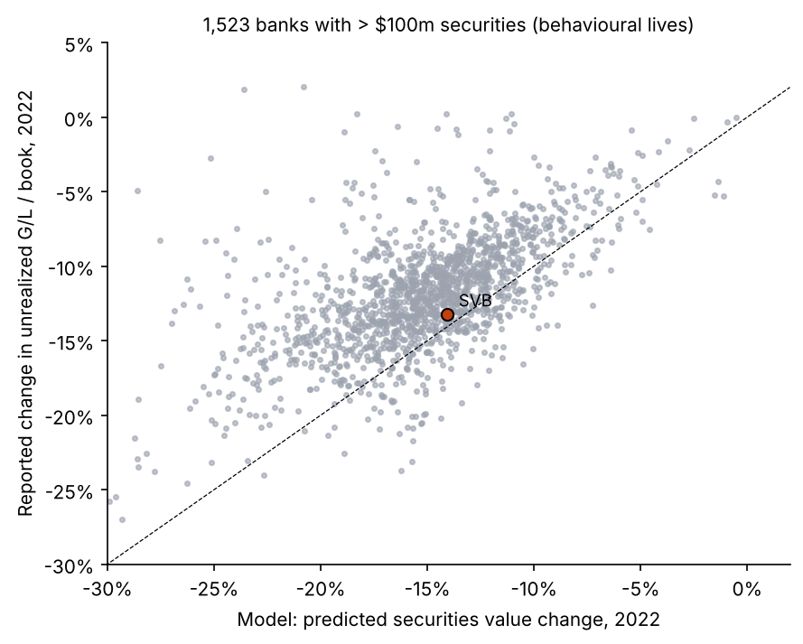

# M6: Interest-rate risk in the banking book and liquidity

Generated by `bastion report alm` from FDIC Call Report repricing buckets (`alm_position`) and
the US Treasury par curve (`treasury_par_curve`). All inputs are public. The measures are
modelled on the BCBS IRRBB standard (d368, 2016) and the US LCR/NSFR rules, simplified to what
the Call Report discloses; they are analytical proxies, not regulatory figures.

## Summary

- **The standard IRRBB test would have flagged SVB before a single hike.** On its
  2021-12-31 balance sheet, with the generous BCBS caps on deposit stability, SVB's worst-case
  EVE decline was 44% of Tier 1, against a supervisory outlier
  threshold of 15%. Among 156 banks over $10bn it ranked 21 of 156.
  If its uninsured deposits are not treated as stable, the decline is
  84%.
- **The test is not unusual to fail.** 66% of large banks and
  63% of all 4,622 banks breached 15% at end-2021 on this model, because a
  +200bp shock from near-zero rates hits long fixed-rate assets hard (and the backtest below
  shows the model overstates duration somewhat). SVB was in the top seventh of large banks, not
  at the very top; what set it apart was that exposure combined with an uninsured, concentrated
  deposit base.
- **Liquidity proxies looked adequate at end-2021 and stopped mattering in March 2023.** The
  LCR proxy assumes 40% of uninsured deposits leave in 30 days; SVB lost about a quarter of all
  deposits in one day. Under the observed two-day run, SVB's cash plus unencumbered securities
  (at fair value, after a 5% haircut) lasted 1.2 days on its
  2022-12-31 balance sheet.
- **The rate model is checked against what banks later reported.** Revaluing each bank's
  securities buckets under the actual curve move predicts the reported change in unrealized
  losses with correlation 0.6-0.7 across 1,300-1,500 banks, in both the 2013 taper tantrum and
  2022. It overstates the size by 2-3 percentage points, mainly because buckets are treated as
  zero-coupon positions; that bias is conservative and is stated, not tuned away.

## SVB, before and after the hikes

| measure                                                         | 2021-12-31   | 2022-12-31   |
|:----------------------------------------------------------------|:-------------|:-------------|
| Worst EVE decline / Tier 1 (BCBS NMD caps)                      | 44% (+200bp) | 29% (+200bp) |
| Worst EVE decline / Tier 1 (uninsured not core)                 | 84% (+200bp) | 56% (+200bp) |
| EVE change at +200bp / Tier 1 (caps)                            | -44%         | -29%         |
| 12-month NII at +200bp / Tier 1 (caps)                          | -8.9%        | -6.7%        |
| 12-month NII at -200bp / Tier 1 (caps)                          | 8.9%         | 6.7%         |
| LCR proxy (40% uninsured outflow)                               | 109%         | 106%         |
| LCR proxy at 100% uninsured outflow                             | 41%          | 39%          |
| NSFR proxy                                                      | 161%         | 147%         |
| Survival days: slow (2008-style): 1%/day of uninsured           | 77.5         | 43.1         |
| Survival days: LCR-calibrated: 40% of uninsured over 30 days    | survives     | survives     |
| Survival days: SVB-observed: 24% then 57% of deposits in 2 days | 1.7          | 1.2          |

## Validating the rate model against reported fair values

For each bank: revalue its securities repricing buckets at t0 under the actual Treasury zero
curve at t1, and compare with the reported change in unrealized gain/loss over the year,
divided by book value at t0. Banks whose securities book changed by more than 50% are dropped.
Both duration mappings were fixed before the test; neither was fitted.

| year       | duration mapping      |   banks |   correlation | predicted (aggregate)   | reported (aggregate)   | median error   | mean abs error   |
|:-----------|:----------------------|--------:|--------------:|:------------------------|:-----------------------|:---------------|:-----------------|
| 2012->2013 | contractual midpoints |    1347 |          0.59 | -9.1%                   | -3.0%                  | -5.2pp         | 5.6pp            |
| 2012->2013 | behavioural lives     |    1347 |          0.68 | -4.9%                   | -3.0%                  | -2.5pp         | 2.8pp            |
| 2021->2022 | contractual midpoints |    1523 |          0.66 | -20.8%                  | -9.8%                  | -7.1pp         | 7.6pp            |
| 2021->2022 | behavioural lives     |    1523 |          0.61 | -13.5%                  | -9.8%                  | -3.0pp         | 3.8pp            |

The behavioural mapping (amortising MBS and residential loans at conventional average lives) is
used for EVE everywhere else in this report.

## Peers

### 31 December 2021 (before the first hike)

| bank                              | worst dEVE / T1   | BCBS outlier (>15%)   | dEVE / T1, uninsured not core   | NII +200 / T1   | LCR proxy   | NSFR proxy   | days, LCR-calibrated run   |   days, SVB-observed run |
|:----------------------------------|:------------------|:----------------------|:--------------------------------|:----------------|:------------|:-------------|:---------------------------|-------------------------:|
| First Republic Bank (failed 2023) | 59%               | yes                   | 84%                             | -8.1%           | 47%         | 103%         | 21.7                       |                      1   |
| Silicon Valley Bank (failed 2023) | 44%               | yes                   | 84%                             | -8.9%           | 109%        | 161%         | survives                   |                      1.7 |
| Banc of California (PacWest)      | 39%               | yes                   | 67%                             | -6.4%           | 107%        | 116%         | survives                   |                      1.5 |
| Western Alliance Bank             | 35%               | yes                   | 55%                             | -7.2%           | 8%          | 96%          | 13.9                       |                      0.7 |
| Huntington National Bank          | 27%               | yes                   | 52%                             | -5.3%           | 58%         | 102%         | 16.8                       |                      0.8 |
| Zions Bancorporation              | 25%               | yes                   | 51%                             | -5.8%           | 106%        | 122%         | survives                   |                      1.5 |
| Comerica Bank                     | 21%               | yes                   | 7%                              | 2.5%            | 215%        | 126%         | survives                   |                      1.5 |
| Citizens Bank                     | 17%               | yes                   | 32%                             | -1.9%           | 76%         | 106%         | 27.6                       |                      1.2 |
| KeyBank                           | 11%               | no                    | 30%                             | -3.4%           | 119%        | 120%         | survives                   |                      1.4 |
| M&T Bank                          | 9%                | no                    | 16%                             | 1.7%            | 197%        | 124%         | survives                   |                      1.5 |
| Fifth Third Bank                  | 5%                | no                    | 24%                             | -0.4%           | 148%        | 118%         | survives                   |                      1.4 |
| Signature Bank (failed 2023)      | 4%                | no                    | 45%                             | -4.5%           | 124%        | 108%         | survives                   |                      1.3 |

### 31 December 2022

| bank                              | worst dEVE / T1   | BCBS outlier (>15%)   | dEVE / T1, uninsured not core   | NII +200 / T1   | LCR proxy   | NSFR proxy   | days, LCR-calibrated run   |   days, SVB-observed run |
|:----------------------------------|:------------------|:----------------------|:--------------------------------|:----------------|:------------|:-------------|:---------------------------|-------------------------:|
| First Republic Bank (failed 2023) | 52%               | yes                   | 70%                             | -8.7%           | 16%         | 100%         | 13.7                       |                      0.7 |
| Silicon Valley Bank (failed 2023) | 29%               | yes                   | 56%                             | -6.7%           | 106%        | 147%         | survives                   |                      1.2 |
| Banc of California (PacWest)      | 23%               | yes                   | 37%                             | -2.7%           | 94%         | 104%         | 25.1                       |                      1.1 |
| Zions Bancorporation              | 17%               | yes                   | 32%                             | -4.9%           | 34%         | 101%         | survives                   |                      1.3 |
| Western Alliance Bank             | 14%               | no                    | 28%                             | -1.9%           | 19%         | 92%          | 17.4                       |                      0.9 |
| Signature Bank (failed 2023)      | 13%               | no                    | 36%                             | -5.7%           | 37%         | 83%          | 23.6                       |                      1   |
| Huntington National Bank          | 13%               | no                    | 29%                             | -2.9%           | 94%         | 108%         | 16.6                       |                      0.9 |
| Citizens Bank                     | 10%               | no                    | 22%                             | -1.8%           | 110%        | 103%         | 29.5                       |                      1.2 |
| KeyBank                           | 9%                | no                    | 23%                             | -4.0%           | 61%         | 103%         | survives                   |                      1.3 |
| Fifth Third Bank                  | 9%                | no                    | 22%                             | -1.8%           | 100%        | 110%         | survives                   |                      1.4 |
| Comerica Bank                     | 6%                | no                    | 11%                             | 0.7%            | 141%        | 101%         | survives                   |                      1.3 |
| M&T Bank                          | 6%                | no                    | 15%                             | 0.4%            | 182%        | 114%         | survives                   |                      1.4 |

## All banks at 31 December 2021

Largest worst-case EVE declines among banks over $10bn:

| bank                                       |   assets $bn | worst dEVE / T1   |
|:-------------------------------------------|-------------:|:------------------|
| Pacific Premier Bank, National Association |         21.1 | 68%               |
| MidFirst Bank                              |         32.1 | 63%               |
| FirstBank                                  |         28.8 | 62%               |
| Community Bank, National Association       |         15.3 | 61%               |
| Wilmington Trust, National Association     |         12   | 60%               |

## Method

- **Positions.** Securities (RC-B Memo 2), loans (RC-C Memo 2), time deposits and borrowings
  by repricing or remaining-maturity bucket, each a zero-coupon position at the bucket
  midpoint, or at a behavioural average life for MBS, CMOs and residential loans. Cash reprices
  overnight. Non-rate-sensitive assets, other liabilities and equity are excluded.
- **Deposits without a maturity.** Insured = retail, uninsured = wholesale; transaction
  accounts (TRN) set the retail transactional share. Core shares and average maturities at the
  BCBS d368 Table 2 caps (90%/5y, 70%/4.5y, 50%/4y). The "uninsured not core" variant makes
  wholesale deposits reprice overnight. NII uses deposit betas of 0.35 (retail) and 0.70
  (wholesale), or 1.0 in the run-prone variant.
- **Curves and shocks.** Treasury par yields bootstrapped to a continuous zero curve
  (`bastion.alm.curves`, tested to reprice par bonds); six BCBS USD shocks (200/300/150bp).
- **LCR proxy.** HQLA = cash + Treasuries + GNMA (Level 1), other agency MBS at 85% (Level 2A),
  munis at 50% (Level 2B), securities at fair value, with the 40%/15% caps. Outflows: 5% insured,
  40% uninsured, repo and 1/12 of borrowings due within a year. Inflows: half of loans repricing
  within 30 days, capped at 75% of outflows. Not captured: commitments, derivatives,
  operational deposits, encumbrance detail.
- **NSFR proxy.** ASF: equity 100%, insured deposits 90%, uninsured 50%, borrowings over a year
  100%; RSF: Level 1 securities 5%, other securities 15%, residential mortgages 65%, other loans
  85%, other assets 100%.
- **Survival.** Cash plus unencumbered securities at fair value (pledged securities removed),
  after a haircut, against cumulative daily outflows. No discount-window or FHLB capacity is
  assumed beyond what the balance sheet already shows.

## Limitations

- The bucket model ignores coupons inside a bucket and loan fair values, so it overstates
  duration (see the backtest) and cannot see First Republic's main exposure: low-rate jumbo
  mortgages held as loans, which the loan buckets capture only by repricing date.
- Uninsured deposit estimates (DEPUNA) are self-reported and only required above $1bn.
- Run speed in 2023 was driven by concentration and social-media coordination that no balance
  sheet ratio measures; the SVB-observed scenario is taken from the Fed's April 2023 review.

Hashes of every result table: `m6-alm-hashes.json`. Reproduce: `bastion ingest --source
fdic-alm-case-study,fdic-alm-quarter --quarters 20121231,20131231,20211231,20221231 && bastion
build --target dev && bastion report alm`
