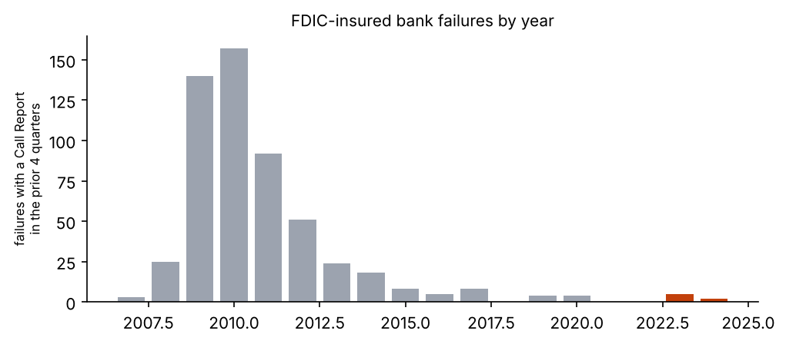

# M7: Bank early-warning model

Generated by `bastion report ews`. Predicts whether an FDIC-insured bank fails within the next
four quarters from its Call Report. Data: 514,093 bank-quarters for 9,806 banks,
2005-2023 (`ews_features`). Labels: FDIC failures (open-bank assistance excluded).

Two models are always fitted side by side: a regularised logistic regression on winsorised,
standardised ratios (the benchmark) and a LightGBM challenger with monotone constraints. Two
feature sets: **camels** (capital, asset quality, earnings, liquidity, concentration, growth)
and **camels_rate_run**, which adds unrealized securities G/L to Tier 1, uninsured deposit share
and the share of long-term assets.

## Test 1: the 2008 crisis tail

Train on report dates 2006-Q1 to 2009-Q4, test on 2010-Q1 to 2012-Q4. No test-period data is
used for fitting, winsorising, imputing or scaling.

| features        | model    |   AUC in-sample |   AUC out-of-time |   avg precision OOT | top-decile capture OOT   |
|:----------------|:---------|----------------:|------------------:|--------------------:|:-------------------------|
| camels          | logistic |           0.98  |             0.987 |               0.447 | 98%                      |
| camels          | LightGBM |           0.996 |             0.992 |               0.638 | 99%                      |
| camels_rate_run | logistic |           0.983 |             0.985 |               0.434 | 98%                      |
| camels_rate_run | LightGBM |           0.997 |             0.992 |               0.652 | 99%                      |

These AUCs are high partly because failure is mechanical: Prompt Corrective Action requires a
critically undercapitalised bank to be closed, so a bank whose leverage ratio is collapsing is
easy to rank. Restricting the test to banks that were still **well capitalised** (Tier 1
leverage at least 5%) at the report date removes that shortcut:

| features        | model    |   bank-quarters |   failures |   AUC out-of-time |
|:----------------|:---------|----------------:|-----------:|------------------:|
| camels          | logistic |          88,311 |         66 |             0.954 |
| camels          | LightGBM |          88,311 |         66 |             0.962 |
| camels_rate_run | logistic |          88,311 |         66 |             0.956 |
| camels_rate_run | LightGBM |          88,311 |         66 |             0.961 |

## Test 2: the 2023 failures

Train on 2006-Q1 to 2019-Q4 (labels known through 2020), then score every bank's
2022-12-31 Call Report. Rank 1 = highest predicted risk.

| bank                     | failed     | camels / LightGBM   | camels / logistic   | camels_rate_run / LightGBM   | camels_rate_run / logistic   |
|:-------------------------|:-----------|:--------------------|:--------------------|:-----------------------------|:-----------------------------|
| Silicon Valley Bank      | 2023-03-10 | 1954 of 4773        | 2586 of 4773        | 1465 of 4773                 | 1682 of 4773                 |
| Signature Bank           | 2023-03-12 | 936 of 4773         | 1758 of 4773        | 488 of 4773                  | 733 of 4773                  |
| First Republic Bank      | 2023-05-01 | 839 of 4773         | 1298 of 4773        | 628 of 4773                  | 403 of 4773                  |
| Heartland Tri-State Bank | 2023-07-28 | 1280 of 4773        | 297 of 4773         | 870 of 4773                  | 304 of 4773                  |
| Citizens Bank            | 2023-11-03 | 15 of 4773          | 13 of 4773          | 7 of 4773                    | 7 of 4773                    |

AUC on this snapshot (only 5 failures, so treat as
indicative): camels/logit 0.75, camels/gbm 0.79, camels_rate_run/logit 0.87, camels_rate_run/gbm 0.86.

## What this shows

- On credit-driven failures the models work out of time, including on banks that still looked
  well capitalised.
- **SVB stayed in the middle of the pack.** With CAMELS features it ranked
  2586 of 4773 (logistic) and 1954 of 4773 (LightGBM). Adding rate and run
  features moved it to 1682 of 4773 and 1465 of 4773.
  The rate and run terms are learned with moderate weights (logistic coefficients:
  unrealized_gain_to_tier1 -0.36, uninsured_deposit_share +0.26, long_term_assets_share +0.02), and they lift the 2023 failures as a group (snapshot AUC rises from
  0.75 to 0.87 for the
  logistic model; Signature and First Republic move into the riskiest sixth). But SVB's strong
  capital ratio, earnings and loan quality outweigh them, because 2006-2019 contains almost no
  failures in which a well-capitalised, profitable bank was killed by rate losses plus a run. A
  statistical model cannot weight a failure mode it has barely seen. That is the argument for
  scenario-based rate and liquidity stress tests (M6, M8) next to statistical models, and the
  main lesson of the case study.
- Citizens Bank (Sac City, Iowa), a small credit failure, ranks in the top 15 under every model:
  the classic failure the model was built for.

## Most influential logistic terms (camels, 2006-2019 fit)

Standardised coefficients; positive raises failure risk.

|                          |   coefficient |
|:-------------------------|--------------:|
| tier1_leverage           |        -4.626 |
| equity_to_assets         |        -1.778 |
| securities_to_assets     |        -1.138 |
| roa                      |        -0.475 |
| cash_to_assets           |        -0.376 |
| past_due_30_89_ratio     |         0.326 |
| brokered_deposit_share   |         0.394 |
| deposit_growth_yoy       |         0.402 |
| noncurrent_loan_ratio    |         0.523 |
| volatile_liability_share |         0.689 |

## Reproducibility

Score hashes for each run are in `m7-ews-hashes.json` (ADR 0005). LightGBM runs single-threaded
with `deterministic=True`, so the same data gives the same hash.

## Limitations

- The FDIC API's Call Report fields are harmonised but coarse: no loan-level rate risk, no
  intra-quarter funding data, and `DEPUNA` exists only for banks that report it.
- Failures are rare outside 2009-2012, so post-2013 performance estimates are noisy.
- No supervisory (CAMELS rating) or market data is used; both would help, neither is public.

Reproduce: `bastion ingest --source fdic-failures && bastion ingest --source fdic-quarter
--quarters <2005Q1..2023Q4> && bastion build --target dev && bastion report ews`
