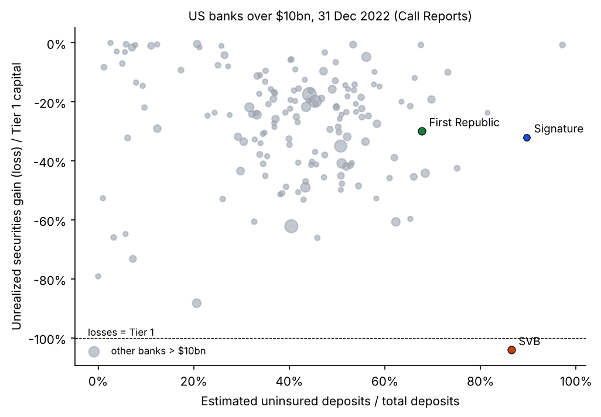
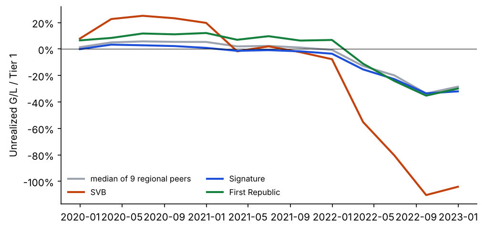

# M7: Silicon Valley Bank, read from its public Call Reports

Generated by `bastion report svb` from the FDIC Call Report data in the lakehouse
(`bank_quarter`). Amounts in USD; all inputs are public quarterly filings. This is an
analysis of public data, not a statement about any bank's supervision.

## Summary

- **The loss was visible a year early.** SVB's unrealized securities losses passed half of its
  Tier 1 capital in **2022-Q1** and exceeded all of it by **2022-Q3**
  (-110%).
  At 2022-12-31 it held 17.7bn of unrealized losses against
  17.0bn of Tier 1. Among the 158 US banks with more than $10bn of assets,
  it was the deepest.
- **The funding was the fragile part.** 86% of deposits were
  uninsured (rank 3 among large banks).
  Only 3 large bank(s) combined losses beyond 50% of Tier 1 with uninsured deposits
  above 60%: Citizens Business Bank, National Association; Silicon Valley Bank; The Bank of New York Mellon.
- **Reported capital looked fine; marked-to-market capital did not.** Reported Tier 1 leverage
  was 8.0%. With securities at fair value it was
  -0.3%.
- **Credit metrics gave no warning.** Noncurrent loans were 0.19%
  of loans and ROA was 0.96%. A model trained on credit-driven failures
  (2008-2012) has nothing to react to here; see the early-warning results below.
- **Run arithmetic.** The Fed's April 2023 review reports $42bn withdrawn on 9 March and about
  $100bn more requested for 10 March. That is 24%, and then a cumulative 81%, of the
  deposits reported at 2022-12-31, against liquid resources at fair value (cash + AFS + HTM
  fair value) equal to 76% of uninsured deposits, most of them
  securities that could only be sold or pledged at a loss.

## SVB quarter by quarter

| quarter    |   assets $bn | deposit growth y/y   | uninsured share   | securities / assets   | HTM share of securities   |   unrealized G/L $bn | unrealized G/L / Tier 1   | reported leverage   | MTM leverage   |
|:-----------|-------------:|:---------------------|:------------------|:----------------------|:--------------------------|---------------------:|:--------------------------|:--------------------|:---------------|
| 2019-12-31 |         69.9 | n/a                  | 81%               | 40%                   | 50%                       |                  0.4 | 8%                        | 7.3%                | 7.6%           |
| 2020-03-31 |         73.6 | n/a                  | 83%               | 36%                   | 52%                       |                  1.2 | 23%                       | 7.2%                | 8.5%           |
| 2020-06-30 |         84.5 | n/a                  | 85%               | 37%                   | 41%                       |                  1.3 | 25%                       | 6.9%                | 7.9%           |
| 2020-09-30 |         95.2 | n/a                  | 86%               | 41%                   | 33%                       |                  1.3 | 23%                       | 6.4%                | 7.2%           |
| 2020-12-31 |        113.8 | 64%                  | 86%               | 42%                   | 35%                       |                  1.3 | 20%                       | 6.4%                | 6.9%           |
| 2021-03-31 |        140.3 | 100%                 | 86%               | 48%                   | 61%                       |                 -0.2 | -2%                       | 7.2%                | 6.2%           |
| 2021-06-30 |        161.2 | 94%                  | 86%               | 52%                   | 72%                       |                  0.2 | 2%                        | 7.0%                | 6.6%           |
| 2021-09-30 |        188.3 | 100%                 | 87%               | 56%                   | 78%                       |                 -0.3 | -2%                       | 7.3%                | 6.8%           |
| 2021-12-31 |        208.6 | 86%                  | 87%               | 60%                   | 78%                       |                 -1.1 | -8%                       | 7.2%                | 6.5%           |
| 2022-03-31 |        217.8 | 60%                  | 86%               | 57%                   | 79%                       |                 -8.3 | -55%                      | 7.1%                | 3.1%           |
| 2022-06-30 |        211.8 | 29%                  | 87%               | 58%                   | 79%                       |                -13.2 | -80%                      | 7.6%                | 1.5%           |
| 2022-09-30 |        210.2 | 4%                   | 87%               | 57%                   | 78%                       |                -18.7 | -110%                     | 7.9%                | -0.8%          |
| 2022-12-31 |        209   | -8%                  | 86%               | 56%                   | 78%                       |                -17.7 | -104%                     | 8.0%                | -0.3%          |

"MTM leverage" = (Tier 1 + unrealized gain/loss on HTM and AFS securities) / total assets. It is
an analytical measure, not a regulatory ratio.

## Peers at 2022-12-31

Percentile = share of banks over $10bn with a *lower* (worse) ratio, so 0 means the worst.

| bank                              |   assets $bn | uninsured share   | unrealized G/L / Tier 1   |   pctile (large banks) | liquid FV / uninsured   | MTM leverage   | noncurrent loans   | ROA   |
|:----------------------------------|-------------:|:------------------|:--------------------------|-----------------------:|:------------------------|:---------------|:-------------------|:------|
| Silicon Valley Bank (failed 2023) |        209   | 86%               | -104%                     |                      0 | 76%                     | -0.3%          | 0.19%              | 0.96% |
| KeyBank                           |        187.6 | 52%               | -42%                      |                     20 | 67%                     | 5.2%           | 0.39%              | 1.15% |
| Comerica Bank                     |         85.5 | 62%               | -39%                      |                     26 | 56%                     | 5.6%           | 0.49%              | 1.30% |
| Huntington National Bank          |        182.3 | 56%               | -33%                      |                     32 | 53%                     | 5.6%           | 0.64%              | 1.36% |
| Signature Bank (failed 2023)      |        110.4 | 90%               | -32%                      |                     34 | 40%                     | 6.2%           | 0.32%              | 1.15% |
| Fifth Third Bank                  |        206.3 | 52%               | -32%                      |                     35 | 70%                     | 6.3%           | 0.62%              | 1.29% |
| First Republic Bank (failed 2023) |        212.6 | 68%               | -30%                      |                     38 | 26%                     | 5.8%           | 0.07%              | 0.85% |
| Banc of California (PacWest)      |         41.2 | 50%               | -28%                      |                     41 | 53%                     | 5.9%           | 0.38%              | 1.10% |
| Zions Bancorporation              |         89.5 | 50%               | -22%                      |                     55 | 70%                     | 6.0%           | 0.28%              | 1.01% |
| Western Alliance Bank             |         67.7 | 55%               | -18%                      |                     65 | 31%                     | 6.9%           | 1.37%              | 1.64% |
| Citizens Bank                     |        226.4 | 49%               | -16%                      |                     71 | 49%                     | 7.7%           | 0.96%              | 1.03% |
| M&T Bank                          |        200.3 | 47%               | -10%                      |                     82 | 63%                     | 7.5%           | 2.28%              | 1.10% |

Signature's securities losses were ordinary; its exposure was the most concentrated uninsured
(largely crypto-linked) deposit base. First Republic's losses sat mostly in low-rate mortgages
held at amortised cost, which these securities fields do not capture; M6's EVE model covers
loans. Both points show why the early-warning model needs rate and run features, not only
credit ones.

## Would an early-warning model have flagged SVB?

Not one trained on history. Scored on its 2022-12-31 filing, SVB ranked 2586 of 4773 under the CAMELS logistic model and 1465 of 4773 under LightGBM with rate and run features. See [m7-early-warning.md](m7-early-warning.md).

## Method and limitations

- Fields: unrealized G/L = (SCHF - SCHA) + (SCAF - SCAA); Tier 1 = RBCT1J; uninsured deposits =
  DEPUNA (self-reported estimate, required only above $1bn); cash = CHBAL.
- Fair-value losses on loans are not in Call Report schedule RC-B, so the loss and MTM measures
  understate rate exposure for loan-heavy banks such as First Republic.
- Quarter-end snapshots miss intra-quarter moves; the run figures come from the Fed's review,
  not from filings.

Reproduce: `bastion ingest --source fdic-case-study,fdic-failures && bastion ingest --source
fdic-quarter --quarters 20221231 && bastion build --target dev && bastion report svb`
